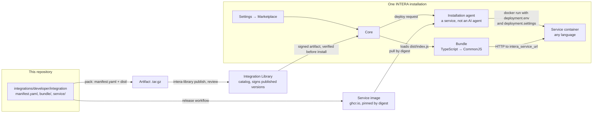

# INTERA Integrations

The public home of integrations for INTERA, built by INTERA and by
third-party developers. Each integration in this repository is released as a
version in the INTERA **Integration Library**, the catalog that every INTERA
installation browses and installs from in **Settings → Marketplace**.

This README is the map. The details live in [`docs/`](docs/).

- [What an integration is](#what-an-integration-is)
- [How it works](#how-it-works)
- [Quick start in 10 minutes](#quick-start-in-10-minutes)
- [Repository layout](#repository-layout)
- [Local development and testing](#local-development-and-testing)
- [Publishing](#publishing)
- [Quality and security rules](#quality-and-security-rules)
- [Versions and compatibility](#versions-and-compatibility)
- [FAQ](#faq)
- [Support and documentation](#support-and-documentation)
- [License](#license)

## What an integration is

INTERA collects metrics, assets and dashboards of a company from the systems
it already uses. An **integration** connects INTERA to one such system: an
accounting package, a CRM, an internal database behind an API, a file
export. It reads the data and hands it to INTERA as **data sources**, which
administrators then use in metrics, assets and dashboards.

An integration has up to three parts:

| Part | Required | What it is |
| --- | --- | --- |
| `manifest.yaml` | yes | Describes the version for the catalog: id, version, compatibility, categories, license and how to deploy the service. [Reference](docs/manifest-reference.md) |
| Bundle | yes | A small CommonJS module (`dist/index.js`), usually written in TypeScript, that INTERA **Core** loads. It declares data sources and returns rows. [Contract](docs/bundle-contract.md) |
| Service | no | Your own code in a Docker container, in **any language**. The bundle calls it over HTTP. Use it for heavy logic, libraries, long-lived processes or local state. [Docker services](docs/docker-services.md) |

Why build one: once your integration is in the catalog, any INTERA
installation can install it with one click, keep it up to date, and verify
that what it runs is exactly what was reviewed.

## How it works



What happens when an administrator clicks **Install** in
**Settings → Marketplace**:

1. **Catalog.** Core asks the Integration Library for the newest version
   whose `compatibility` matches this installation (INTERA version and
   Integration Contract).
2. **Signature.** Core downloads the artifact (`manifest.yaml` + `dist/`) and
   checks it before running any code: the digests, the catalog signature
   made when INTERA published the version, and that the archive holds only
   `manifest.yaml` and `dist/`.
3. **Service** (only with `deployment.type: docker`). Core asks the
   **installation agent** to deploy the container. The agent is a small
   service of each installation, not an AI agent; it is the only part with
   access to Docker. It pulls `deployment.image` by digest, starts it in the
   installation's internal network with the fixed `deployment.env` values
   and the values of **`deployment.settings`** that the administrator filled
   in the install dialog (secrets are stored encrypted), and waits until
   `deployment.health_path` answers 2xx.
4. **Bundle.** Core installs the bundle and restarts to load it. For a Docker
   integration it passes the container address to the bundle as
   **`intera_service_url`** in `context.config`, for example
   `http://<container>:8080`.
5. **Connection.** The administrator creates a connection in
   **Settings → Integrations**, fills the connection fields the bundle
   declares (`configSchema`), and uses its data sources.

Updates work the same way: the new container starts next to the old one and
takes over only when healthy; otherwise the old version keeps running.

## Quick start in 10 minutes

You need **Node.js 20+** with npm and **Docker**. No INTERA installation is
needed: everything below runs on your machine.

**1. Build and test the sample.** [`hello-dotnet`](integrations/intera/hello-dotnet/)
is a complete integration: a TypeScript bundle in front of a .NET 8 service.

```bash
git clone https://github.com/Intera-Ltd/intera-integrations.git
cd intera-integrations
npm ci                                   # repository tooling

# Bundle: build dist/ and run the unit tests (mocked fetch, no network)
(cd integrations/intera/hello-dotnet/bundle && npm ci && npm test)

# Service: build and run the container
docker build -t intera-hello-dotnet:dev integrations/intera/hello-dotnet/service
docker run --rm -d --name hello-dotnet -p 8080:8080 intera-hello-dotnet:dev
curl -s localhost:8080/health            # {"status":"ok"}
```

**2. Call the bundle the way Core does.** `try-bundle.mjs` runs
`testConnection` and every data source against the running container:

```bash
node scripts/try-bundle.mjs integrations/intera/hello-dotnet \
  --service-url http://localhost:8080
docker rm -f hello-dotnet
```

**3. Check the manifest and pack the artifact** that the catalog would get:

```bash
node scripts/validate-manifest.mjs integrations/intera/hello-dotnet
scripts/pack.sh integrations/intera/hello-dotnet    # -> out/intera-hello-dotnet-1.0.0.tar.gz
tar -tzf out/intera-hello-dotnet-1.0.0.tar.gz        # manifest.yaml and dist/ only
```

**4. Start your own** from a template. Pick
[`bundle-only`](templates/bundle-only/) when the bundle calls an external API
directly, or [`bundle-with-service`](templates/bundle-with-service/) when the
logic lives in a container. With developer `acme` and integration `billing`:

```bash
mkdir -p integrations/acme
cp -R templates/bundle-with-service integrations/acme/billing
cd integrations/acme/billing
grep -rl 'your-org\|your-integration\|your_integration' . | xargs sed -i.bak \
  -e 's/your-org/acme/g' -e 's/your-integration/billing/g' -e 's/your_integration/acme_billing/g'
find . -name '*.bak' -delete
(cd bundle && npm install && npm test)   # npm install refreshes package-lock.json; commit it
cd ../../..
node scripts/validate-manifest.mjs integrations/acme/billing
```

Then write your data sources in `bundle/src/` and your service in `service/`,
following [Getting started](docs/getting-started.md).

## Repository layout

```
integrations/<developer>/<integration>/   one folder per integration
  manifest.yaml                           catalog manifest
  bundle/                                 TypeScript sources -> dist/index.js, unit tests
  service/                                optional: Dockerfile and service code
  README.md                               what it does, configuration, data sources
  CHANGELOG.md                            one entry per version
  LICENSE                                 only if the integration has its own license
templates/
  bundle-only/                            bundle that calls an external API
  bundle-with-service/                    bundle + container service
docs/                                     guides and references
scripts/
  validate-manifest.mjs                   manifest and layout pre-check (CI runs it)
  pack.sh                                 build the bundle, pack the artifact or the plugin folder
  set-image-digest.sh                     write an image digest into a manifest
  try-bundle.mjs                          call a built bundle as Core does
  smoke-service.mjs                       run the image, wait for health, call the bundle
  changed-integrations.mjs                which folders a pull request touches (CI)
  test/                                   unit tests of the scripts
.github/                                  CI workflows, issue and pull request templates, CODEOWNERS
```

`<developer>` is your developer slug in the Integration Library and
`<integration>` is unique across the repository: the service image is
published as `ghcr.io/intera-ltd/<integration>`.

## Local development and testing

| What | Command |
| --- | --- |
| Bundle unit tests | `cd integrations/<developer>/<integration>/bundle && npm ci && npm test` |
| Service image | `docker build -t <integration>:dev integrations/<developer>/<integration>/service` |
| Bundle against the running service | `node scripts/try-bundle.mjs <folder> --service-url http://localhost:8080` |
| Bundle-only integration against a real API | `node scripts/try-bundle.mjs <folder> --config base_url=https://api.example.com --config api_key="$API_KEY"` |
| Smoke test as CI runs it | `node scripts/smoke-service.mjs <folder> <integration>:dev` |
| Manifest pre-check | `node scripts/validate-manifest.mjs <folder>` |
| Artifact | `scripts/pack.sh <folder>` |
| Everything, as CI does | `npm test && node scripts/validate-manifest.mjs --all` |

Bundle tests load `dist/index.js` the way Core does and replace `fetch` with
a mock. Cover the happy path, missing configuration, upstream errors and
malformed answers, that `context.signal` reaches `fetch`, and that errors
never contain secrets. If your service has `deployment.settings`, pass them
with `docker run -e NAME=fake-value`. More in
[Testing locally](docs/testing-locally.md).

The pull request workflow runs the same steps for every integration and
template you change: bundle tests, the image build (`linux/amd64`), the smoke
test and packing. It has a read-only token and no secrets.

## Publishing

A version goes **pull request → release → catalog review → Marketplace**.

1. **Pull request.** Bump `version` in `manifest.yaml`, `bundle/src/constants.ts`
   and `bundle/package.json`, add a `CHANGELOG.md` entry, open a pull request.
   CI must pass and a maintainer reviews it against the
   [review guidelines](docs/review-guidelines.md).
2. **Release.** After the merge a maintainer pushes the tag
   `<developer>/<integration>/v<version>`, for example
   `intera/hello-dotnet/v1.0.0`. The release workflow builds and tests the
   bundle, pushes the image `ghcr.io/intera-ltd/<integration>:<version>` for
   `linux/amd64` and `linux/arm64`, writes its digest into the packed
   manifest and attaches `<developer>-<integration>-<version>.tar.gz` to a
   GitHub release.
3. **Catalog.** The version is uploaded to the Integration Library with the
   `intera-library` CLI. It takes a **plugin folder**: `manifest.yaml` with
   the real image digest and the built `dist/`, which is exactly the content
   of the release archive.

   ```bash
   mkdir -p out/acme-billing-1.2.0
   tar -xzf acme-billing-1.2.0.tar.gz -C out/acme-billing-1.2.0
   intera-library pack out/acme-billing-1.2.0      # offline check with the catalog's rules
   export INTERA_LIBRARY_TOKEN=...                 # your developer token, never commit it
   intera-library publish out/acme-billing-1.2.0 \
     --release-notes-file integrations/acme/billing/CHANGELOG.md --submit
   ```

   `publish` uploads a draft and, with `--submit`, sends it for review; add
   `--breaking-changes` for a breaking version. Uploading needs a developer
   account and token, which INTERA issues: ask in a
   [New integration](https://github.com/Intera-Ltd/intera-integrations/issues/new/choose)
   issue.
4. **Review and Marketplace.** INTERA reviews the version and publishes it;
   publishing signs the artifact with the INTERA key, and installations
   verify that signature before installing. The version then appears in
   **Settings → Marketplace** of every compatible installation, and as an
   update where an older version is installed.

All options, including packing from the repository with
`scripts/pack.sh --image <ref> --stage-dir <dir>`, are in
[Publishing](docs/publishing.md).

## Quality and security rules

This repository is public and the catalog is shared by every installation.
Reviewers reject a pull request that breaks these rules; CI enforces some.

- **No secrets anywhere**: not in `manifest.yaml`, code, tests, Dockerfiles,
  images or commit messages. Secrets of the bundle are `secret` fields of the
  connection (`configSchema`); secrets of the service are
  `deployment.settings` with `kind: secret` and no `default`.
- **No internal details**: no internal hostnames, IP addresses, customer
  names, links to private repositories or names of people. Use
  `example.com` and placeholders.
- **Images only by digest** (`@sha256:...`); the release workflow writes it.
  Keep the placeholder digest in the repository.
- **Bundles**: CommonJS, no runtime dependencies, committed
  `package-lock.json`; a timeout and `context.signal` on every call; validate
  configuration and upstream answers; no `eval`, child processes, file
  writes, telemetry or network calls other than the configured API or
  `intera_service_url`; error messages without secrets or raw upstream bodies.
- **Services**: multi-stage build, official minimal base image, non-root user,
  listen on `deployment.port`, `health_path` answers 2xx only when ready, log
  to stdout/stderr without secrets, fail clearly when a required setting is
  missing.
- **Documentation**: the integration `README.md` describes what it reads,
  its configuration and its data sources; `CHANGELOG.md` has an entry for
  every version.

Read the full [security rules](docs/security.md) and
[review guidelines](docs/review-guidelines.md) before your first pull request.

## Versions and compatibility

- **SemVer.** `version` is `X.Y.Z`, quoted in YAML, and the same in
  `manifest.yaml`, the bundle manifest and `bundle/package.json`.
  - **MAJOR** for breaking changes: a removed or renamed data source or
    field, a changed identity (record key), a removed connection field, a new
    required setting without a default, or a raised `intera_min` that drops
    supported installations.
  - **MINOR** for new data sources, fields or optional settings.
  - **PATCH** for fixes that change no contract.
- **Immutable versions.** A published version is never replaced, only
  deprecated or disabled. Any change, even a rebuild, is a new version.
- **`runtime_id` never changes.** Connections in installations belong to it;
  an update with another `runtime_id` is refused.
- **`compatibility`** decides which installations see a version:

  ```yaml
  compatibility:
    intera_min: '0.5.0'      # lowest INTERA version, inclusive
    intera_max: '1.x'        # optional: X.Y.Z, X.Y.x or X.x, inclusive
    integration_contract: 2  # the Integration Contract the bundle is written against
  ```

  Set `intera_min` to the lowest INTERA version you tested with. The current
  Integration Contract is **2**.
- **Breaking changes** are called out in `CHANGELOG.md` and the pull request
  and published with `intera-library publish --breaking-changes`, so that
  installations warn the administrator before the update.

## FAQ

**Do I need a service?** No. If the bundle can call the external API directly
with a key the administrator enters, use
[`bundle-only`](templates/bundle-only/). Add a service when you need another
language, libraries, heavy processing or state.

**Which languages can the service use?** Any language that runs in a Linux
container and serves HTTP. The sample uses .NET 8; the template uses Node.js.
Images are built for `linux/amd64` and `linux/arm64`.

**Can the bundle use npm packages at runtime?** Only `dist/` goes into the
artifact, without `node_modules`. Keep bundles dependency-free, bundle a
library into `dist/` with a bundler if you really need one, or move the
dependency into your service.

**How does the bundle find the service?** Through
`context.config.intera_service_url`, which Core sets for integrations with a
Docker deployment. Never hardcode the address.

**Where do settings and secrets go?** Connection fields the bundle needs are
declared in its `configSchema`. Values the container needs are
`deployment.settings`; the administrator fills them at install time and can
change them later, which redeploys the container. Fixed public values go in
`deployment.env`.

**Why must the image be pinned by digest?** A tag can be moved, a digest
cannot. Installations run exactly the image that was reviewed.

**Can the image be private?** Yes, but then the operator of every
installation has to give its installation agent a registry login. A public
image works everywhere without setup and is preferred for the public catalog.

**Does installing restart INTERA?** Core restarts to load a new or updated
bundle. Changing container settings redeploys only the container.

**How do I get a developer account?** INTERA issues developer accounts and
tokens for the catalog. Open a
[New integration](https://github.com/Intera-Ltd/intera-integrations/issues/new/choose)
issue to agree on the slug and ask for one.

**Can my integration have its own license?** Yes. The default is Apache-2.0;
see [Licensing](CONTRIBUTING.md#licensing).

## Support and documentation

- [Getting started](docs/getting-started.md): from an empty folder to a pull
  request.
- [Manifest reference](docs/manifest-reference.md): every field of
  `manifest.yaml`, including `deployment.settings`.
- [Bundle contract](docs/bundle-contract.md): what Core expects from
  `dist/index.js`.
- [Docker services](docs/docker-services.md): running your own service,
  settings, private registries.
- [Testing locally](docs/testing-locally.md), [Publishing](docs/publishing.md),
  [Review guidelines](docs/review-guidelines.md),
  [Security rules](docs/security.md).
- Questions and new integrations:
  [open an issue](https://github.com/Intera-Ltd/intera-integrations/issues/new/choose)
  (**New integration** or **Bug report**).
- Vulnerabilities: report them privately as described in
  [SECURITY.md](SECURITY.md), never in a public issue.
- Contributing: [CONTRIBUTING.md](CONTRIBUTING.md) and the
  [Code of Conduct](CODE_OF_CONDUCT.md).

### Integrations in this repository

| Integration | Developer | Shape | Description |
| --- | --- | --- | --- |
| [Hello .NET](integrations/intera/hello-dotnet/) | `intera` | bundle + .NET 8 service | Sample data source served by a .NET container |

## License

This repository is licensed under the [Apache License 2.0](LICENSE).
Contributions are accepted under the same license (section 5 of the
license). An integration may declare its own license with a `LICENSE` file in
its folder and the `license` field in `manifest.yaml`; see
[Licensing](CONTRIBUTING.md#licensing).
